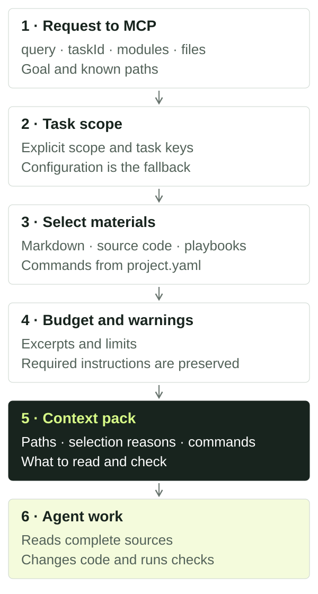

# Context packs

A context pack selects material for one task: project memory records, source paths, excerpts, instructions and verification commands. It helps an agent decide what to read and check before changing code.

For ordinary repository work, use the `build_context_pack` MCP tool or the `pack` CLI command. Install and connect a client using [quick start](quickstart.html).

## How a pack is built



The diagram simplifies the local pack workflow:

1. **The request supplies the goal.** Pass a description and, when available, `taskId`, modules, files and changed files.
2. **The router selects scope.** Explicit modules and paths guide routing; `taskId` also adds the contract's modules and files. Without explicit scope, exact task/backlog keys and query signals are used. Configured `default_modules` are a fallback. See [configuration](configuration.html) for details and exceptions.
3. **Materials are selected within that scope.** The router searches Markdown records and indexed code capabilities, adding relevant playbooks and commands from `project.yaml`. Each material has a selection reason.
4. **The budget is applied.** Excerpts and some materials may be removed. Required instructions are preserved; if they cannot fit, the pack reports an overrun.
5. **The agent receives the result.** It inspects scope and warnings, reads complete files and instructions, then performs the agreed work and checks.

Verification results and task outcomes are saved through separate tools. Later packs can use those records subject to history filtering. Calling `pack` does not change source files or execute its suggested commands, but it may refresh the local SQLite index and cache.

## Try it on your task

Run from the project root after configuring an `app` module:

```bash
npx project-context index
npx project-context pack "Update CustomerService" --modules app --file src/customer.ts --workflow standard --max-tokens 6000
npx project-context reuse-scan "CustomerService" --modules app
```

Replace `app`, the query and the path with real values. An explicit file is added first among candidates, but a small budget can remove it from the result. `reuse-scan` separately finds existing implementation candidates; read them before reusing them.

The equivalent input to the `build_context_pack` MCP tool:

```json
{
  "query": "Update CustomerService",
  "modules": ["app"],
  "files": ["src/customer.ts"],
  "workflow": "standard",
  "maxTokens": 6000
}
```

A prompt you can send your agent:

> Use project_context: build_context_pack for updating CustomerService in module app, file src/customer.ts. Show the selected scope, selection reasons and warnings. Read the sources and instructions, then find the existing implementation. Investigate only for now; do not change code.

To continue a confirmed task, supply its real ID:

```bash
npx project-context pack "Update CustomerService" --task TASK-ID --modules app --file src/customer.ts
```

`TASK-ID` is a placeholder. `--task` references an existing record; it does not create a contract. See [agent workflow](workflow.html) for agreement and implementation steps.

## Read the response

| Field | How to use it |
| --- | --- |
| `routing.modules`, `routing.basis` | Compare the selected modules and routing basis with the task. Refine the query or provide explicit modules/files if scope is wrong. |
| `routing.unknownModules`, `routing.unmappedFiles` | Check names, aliases and configured path coverage. |
| `records` | Read each record's ID, path, reason and excerpt. Status, dates and provenance do not prove current code behavior. |
| `files` | Open the returned source paths. An excerpt may be shortened or absent; a path can also point to a module directory. |
| `playbooks`, `playbookDetails` | Read the instructions. The pack provides reasons, size estimates and `required` flags, rather than complete playbook text. |
| `commands` | Check the commands and run them in the correct environment. Listing a command does not mean it has run. |
| `warnings`, `budget` | Review dropped material, budget overruns and configuration issues before implementation. |
| `cache` | See whether a pack was reused (`hit`), rebuilt (`miss`) or caching was disabled (`disabled`). |

## Pack size and history

| Setting | When to use it |
| --- | --- |
| `--workflow fast` | Narrow work with fewer candidates. |
| `--workflow standard` | An ordinary task; this is the default. |
| `--workflow strict` | A broader selection for complex work. |
| `--profile local-model` | Compact defaults: `fast` and a budget of 4000. This does not select a model or connect an LLM. |
| `--max-tokens 6000` | Set a size target. Minimum 500; without this flag, the default profile uses 10000, or 16000 with `strict`. |
| `--include-history` | Deliberately include workflow history hidden from ordinary packs. |
| `--include-archive` | Also read archived storage. History filtering is controlled separately. |

Token estimates are approximate; they do not use your model's exact tokenizer. Inspect `estimatedTokens`, `exceedsLimit`, `truncated` and the `dropped*` counters in `budget`. A retained file may still lose its excerpt. Required playbooks can cause `exceedsLimit: true`; lowering the limit does not guarantee a small response.

Completed workflow history is normally hidden. An explicit `taskId` or exact completed-task key can return that task with historical status. To inspect history:

```bash
npx project-context pack "CustomerService history" --modules app --include-history --include-archive
```

Workflow levels change selection and budgets. They do not execute tests or waive acceptance requirements.

## When the result is unhelpful

| Symptom | Next action |
| --- | --- |
| Wrong module selected | Inspect `routing`; pass `--modules` and `--file`, then check aliases and `default_modules`. |
| Missing source file or symbol | Check `source_globs`, the path and supported syntax, then run `index`. Extractors use text heuristics. |
| File listed without an excerpt | Check file existence and `budget.truncated`; read the file directly. |
| Missing project decision | Check whether the record exists, its module, status and archive location. Drafts are normally excluded; explicit `--task` can add its own draft. |
| Too much unrelated material | Supply a specific task, modules and files; try `fast`. Inspect selection reasons. |
| No verification commands | Configure `commands` with appropriate `required_for` and `context_pack: true`. |
| Pack reports truncation | Narrow scope or increase the budget, then read required instructions. |
| Index unavailable | Inspect `doctor` and warnings. Records can be read directly from Markdown, while code capability lookup is limited. |

Index freshness is checked before assembly. The cache lives under `.project-context/indexes/pack-cache/` and accounts for the request and tracked source state. SQLite and caches are rebuildable; durable memory lives in Markdown. `cache.hit` does not prove the selected context is appropriate.

## Local packs and connected sources

`build_context_pack` uses the local repository. `retrieve_project_context` is a separate unified path for a configured portal plus local context; it needs portal configuration and access. It is unnecessary for a local quick start. See [tools and records](reference.html) to choose a tool.

A pack does not establish complete repository understanding, implementation correctness or task acceptance. Read sources, check whether decisions apply and save actual results through the [agent workflow](workflow.html).
