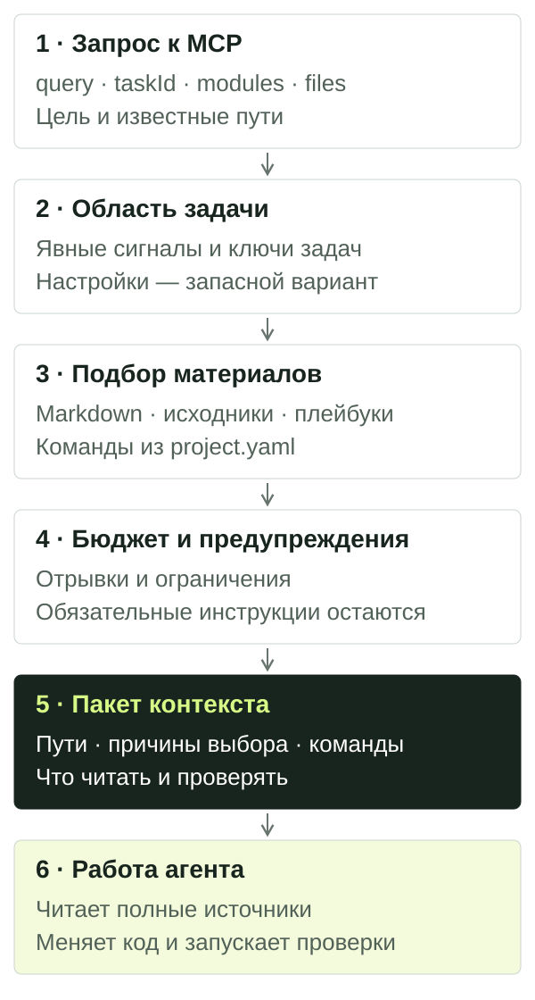

# Пакет контекста

Пакет контекста — подборка материалов для конкретной задачи: записи памяти проекта, пути к исходникам, отрывки, инструкции и команды проверки. Он помогает агенту понять, что читать и проверять перед изменением кода.

Для обычной работы в репозитории используйте MCP-инструмент `build_context_pack` или CLI `pack`. Установка и подключение клиента описаны в [быстром старте](quickstart.html).

## Как собирается пакет



Упрощённая схема локального пакета:

1. **Запрос задаёт цель.** Передайте описание работы, а при наличии — `taskId`, модули, файлы и изменённые файлы.
2. **Роутер определяет область.** Явные модули и пути направляют выбор; `taskId` также добавляет модули и файлы контракта. Без явной области используются точные ключи задач/backlog и сигналы запроса. Настроенные `default_modules` служат запасным вариантом. Подробности и исключения — в [настройке](configuration.html).
3. **Из области выбираются материалы.** Роутер ищет записи Markdown и индексированные сущности кода, добавляет нужные плейбуки и команды из `project.yaml`. Для каждого материала возвращает причину выбора.
4. **Применяется бюджет.** Отрывки и часть материалов могут быть убраны. Обязательные инструкции сохраняются; если они не помещаются, пакет сообщает о превышении.
5. **Агент получает результат.** Он проверяет область и предупреждения, читает полные файлы и инструкции, затем выполняет согласованную работу и проверки.

Результаты проверок и итог задачи сохраняются отдельными инструментами. Следующий пакет может использовать эти записи с учётом фильтрации истории. Сам вызов `pack` не меняет исходники и не запускает команды, но может обновить локальный SQLite-индекс и кеш.

## Попробуйте на своей задаче

Запустите из корня проекта после настройки модуля `app`:

```bash
npx project-context index
npx project-context pack "Update CustomerService" --modules app --file src/customer.ts --workflow standard --max-tokens 6000
npx project-context reuse-scan "CustomerService" --modules app
```

Замените `app`, запрос и путь на реальные. Явный файл попадёт в кандидаты первым, но слишком маленький бюджет может убрать его из результата. `reuse-scan` отдельно ищет существующую реализацию; найденный кандидат нужно прочитать.

Тот же запрос через MCP-инструмент `build_context_pack`:

```json
{
  "query": "Update CustomerService",
  "modules": ["app"],
  "files": ["src/customer.ts"],
  "workflow": "standard",
  "maxTokens": 6000
}
```

Готовый запрос агенту:

> Используй project_context: собери build_context_pack для изменения CustomerService, модуль app, файл src/customer.ts. Покажи выбранную область, причины выбора материалов и предупреждения. Прочитай источники и инструкции, затем найди существующую реализацию. Пока только исследуй, без изменения кода.

Для продолжения подтверждённой задачи добавьте её настоящий ID:

```bash
npx project-context pack "Update CustomerService" --task TASK-ID --modules app --file src/customer.ts
```

`TASK-ID` — заполнитель. `--task` ссылается на существующую запись и не создаёт контракт. Порядок согласования и реализации — в [работе с агентом](workflow.html).

## Как читать ответ

| Поле | Что с ним делать |
| --- | --- |
| `routing.modules`, `routing.basis` | Сверить модули и основание выбора с задачей. Если выбрана другая область, уточнить запрос или передать модули/файлы явно. |
| `routing.unknownModules`, `routing.unmappedFiles` | Проверить имена, алиасы и покрытие путей в конфигурации. |
| `records` | Прочитать найденные записи: ID, путь, причину и отрывок. Статус, дата и происхождение записи не доказывают текущее поведение кода. |
| `files` | Открыть исходники по возвращённым путям. Отрывок может быть сокращён или отсутствовать; путь может указывать на каталог модуля. |
| `playbooks`, `playbookDetails` | Прочитать инструкции. Здесь указаны причина, оценка размера и признак `required`, но не полный текст плейбука. |
| `commands` | Проверить команды и запустить их в нужном окружении. Наличие команды в ответе не означает, что она выполнена. |
| `warnings`, `budget` | Проверить пропуски, превышение бюджета и ошибки настройки до реализации. |
| `cache` | Узнать, был ли пакет взят из кеша (`hit`), собран заново (`miss`) или кеш отключён (`disabled`). |

## Размер пакета и история

| Настройка | Когда использовать |
| --- | --- |
| `--workflow fast` | Небольшая область и короткая подборка кандидатов. |
| `--workflow standard` | Обычная задача; используется по умолчанию. |
| `--workflow strict` | Более широкая подборка материалов для сложной работы. |
| `--profile local-model` | Компактный профиль: по умолчанию `fast` и бюджет 4000. Это не выбор модели и не подключение LLM. |
| `--max-tokens 6000` | Задать ориентир размера. Минимум 500; без флага обычный профиль использует 10000, а `strict` — 16000. |
| `--include-history` | Намеренно включить историю workflow, скрытую в обычной подборке. |
| `--include-archive` | Дополнительно читать архивное хранилище. Фильтр истории управляется отдельно. |

Оценка токенов приблизительная, а не точный подсчёт токенизатором вашей модели. В `budget` смотрите `estimatedTokens`, `exceedsLimit`, `truncated` и счётчики `dropped*`. Даже если файл остался в списке, его отрывок мог быть убран. Обязательные плейбуки могут привести к `exceedsLimit: true`; уменьшение лимита не гарантирует маленький ответ.

Обычно завершённая история скрыта. Явный `taskId` или точный ключ завершённой задачи может вернуть её с историческим статусом. Для обзора истории:

```bash
npx project-context pack "CustomerService history" --modules app --include-history --include-archive
```

Уровни workflow меняют подборку и бюджет. Они не запускают тесты и не отменяют требования приёмки.

## Если результат не помогает

| Симптом | Следующее действие |
| --- | --- |
| Выбран не тот модуль | Сверить `routing`; передать `--modules` и `--file`, проверить алиасы и `default_modules`. |
| Нужного файла или символа нет | Проверить `source_globs`, путь и поддержку синтаксиса, затем выполнить `index`. Парсеры используют текстовые эвристики. |
| Файл в списке, но без отрывка | Проверить существование файла и `budget.truncated`; открыть файл напрямую. |
| Нет нужного решения проекта | Проверить, сохранена ли запись, её модуль, статус и архив. Черновики обычно исключены; явный `--task` может добавить собственный черновик. |
| В пакете много лишнего | Указать конкретную задачу, модули и файлы; попробовать `fast`. Проверить причины выбора. |
| Нет команд проверки | Настроить `commands` с нужными `required_for` и `context_pack: true`. |
| Пакет сообщает о сокращении | Сузить область или увеличить бюджет, затем перечитать обязательные инструкции. |
| Индекс недоступен | Проверить `doctor` и предупреждения. Записи могут читаться напрямую из Markdown, а поиск сущностей кода будет ограничен. |

Перед сборкой проверяется свежесть индекса. Кеш находится в `.project-context/indexes/pack-cache/` и учитывает запрос и состояние отслеживаемых источников. SQLite и кеш можно пересоздать; долговечная память хранится в Markdown. `cache.hit` не доказывает правильность выбранного контекста.

## Локальный пакет и подключения

`build_context_pack` работает с локальным репозиторием. `retrieve_project_context` — отдельный объединённый путь для настроенного портала и локального контекста; ему нужны конфигурация и доступ к порталу. Для локального старта он не требуется. Выбор инструмента описан в [справке](reference.html).

Пакет не обеспечивает полное понимание репозитория, корректность реализации или приёмку задачи. Читайте источники, проверяйте применимость найденных решений и сохраняйте реальные результаты по [рабочему процессу](workflow.html).
